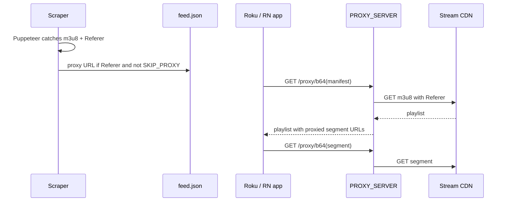

# HLS proxy and feed URLs

This document explains why some streams in `feed.json` go through a local proxy, how that is decided, and how to run or bypass the proxy servers in `proxy/`.

## The problem

Many ppv.st embed players load HLS (`.m3u8`) with a **`Referer`** header (often tied to the embed host, e.g. `taifood-blog.asia`). Roku and mobile players request the manifest URL directly; they do not send the same headers a browser would.

If the CDN rejects requests without that referer, playback fails when the feed points at the raw `.m3u8` URL.

## The solution

A small **LAN HTTP proxy** sits between your clients and the CDN:

1. The client requests `http://<proxy-host>:8787/proxy/<base64-of-real-url>`.
2. The proxy fetches the real manifest or segment with `Referer: https://embedsports.top/` (hardcoded in both proxy apps).
3. For manifests, the proxy rewrites the playlist so segments and encryption keys also point back through `/proxy/...`.

Clients only talk to your proxy; the proxy talks to the stream host.

## When the feed uses a proxy URL vs a direct URL

**Only** `createFeedItem()` in `src/feed-generator.js` decides this when building `feed.json`.

| Condition | URL written to feed |
|-----------|---------------------|
| `SKIP_PROXY=true` in `.env` | Always the **direct** scraped URL |
| Stream has `headers.Referer` (truthy) and proxy not skipped | `http://<proxy>/proxy/<base64(original m3u8)>` (`d=1` when Node replay OK) |
| No `headers.Referer` | **Direct** URL |

### By source

| Source | Typical `streamLinks` | Usually proxied? |
|--------|----------------------|------------------|
| **ppv.st** (live + 24/7) | Referer + `embedUrl`; `d=1` when Node replay OK | Yes, unless `SKIP_PROXY=true` |
| **TimStreams** | Signed `.m3u8` + Referer + `e`; often `d=1` | Yes — Roku needs WebP-TS unwrap |
| **DaddyLive** | Referer + `e`; never `d=1` | Yes — proxy decrypts the sealed playlist and unwraps TIKTIKPX PNG segments |
| **onhockey.tv** | mtchor/streamd/plytvme/sportpl get Referer; fluidtv/brcove often raw CDN | Partial — only when Referer is set |

If Puppeteer does not capture a referer, the stream stays direct. Unchanged feed items keep a signed `u` but advanced-proxy refreshes via payload `e`.

`streamSignature` in the feed always uses the **original** URL (before any proxy rewrite), so diffing games is unaffected.

### Example URLs in `feed.json`

**Proxied:**

```text
http://192.168.1.50:8787/proxy/aHR0cHM6Ly8uLi4ubTN1OA==
```

**Direct:**

```text
https://cdn.example.com/path/playlist.m3u8
```

During a scraper run, proxied streams log:

```text
-- Found referer for stream. Rewriting URL for hardcoded proxy: https://...
```

## Environment variables

| Variable | Default | Purpose |
|----------|---------|---------|
| `SKIP_PROXY` | unset (`false`) | Set to `true` to write **direct** CDN URLs only (no proxy host in the feed). Use when the proxy server is down or you want to test raw playback. |
| `PROXY_SERVER` | `http://192.168.1.50:8787` | Base URL embedded in the feed when proxying. Must match where you run the proxy and what clients can reach on your LAN. |

Add to `.env`:

```env
SKIP_PROXY=true
# PROXY_SERVER=http://192.168.1.50:8787
```

**Note:** Skipping the proxy does not add referer headers on the client. Many ppv.st streams may still fail without the proxy; onhockey / some direct URLs may work anyway.

## Proxy implementation

Run **`proxy/advanced-proxy.js`** on port **8787** (Docker compose does this). Payload shape: `GET /proxy/<base64url JSON { u, r, h?, e?, d? }>`.

- **Stack:** ESM, Express, Puppeteer (`proxy/browser-fetch.js`)
- **d=1 (TimStreams):** HTTP first; Chromium fallback; WebP-TS unwrap for Roku
- **Daddy (`edge.wedd48c.top/premiumN/index.m3u8`):** no browser. `proxy/daddy-playlist.js` gets `{token,k}` from `/api/playlist-token?slug=premiumN`, fetches `index.m3u8?t=token`, and AES-CTR-decrypts each segment line (counter = media sequence) into a TikTok-CDN PNG URL. Segments are plain HTTP; the PNG pixels hold `TIKTIKPX` + gzip(TS). Falls back to the embed path if the token API fails.
- **Otherwise (Streamed / India):** open embed `e`, serve **live** playlist captures (pathname + seq), rewrite segments slim (no cookie headers in URL)
- **Segments:** embed-tab fetch / CDP first when the player is open; Node HTTP fallback; PNG/WebP → MPEG-TS unwrap
- **`/remux/`:** optional ffmpeg AAC-LC path; the feed writes `/proxy/` only
- **Env:** `PROXY_HOST`, `PROXY_DEBUG`, `PROXY_BROWSER_IDLE_MS` (default 10 min)

`proxy/index.js` is retired (exits with a pointer to advanced-proxy).

## End-to-end flow (proxied stream)



## Running the proxy

### Docker (recommended on a server)

The advanced proxy needs Chromium (Puppeteer). Build from the **repo root** so `src/` is available:

```bash
# From repo root — uses proxy/docker-compose.yml
docker compose -f proxy/docker-compose.yml up -d --build
```

Required env (set in shell, a `.env` next to the compose file, or your orchestrator):

```env
PROXY_HOST=192.168.1.50:8787
PROXY_PORT=8787
PROXY_HEADLESS=true
```

- Publish `8787` (or set `PROXY_PORT` if that host port is taken).
- `PROXY_HOST` must be the LAN IP:port clients use (same as scraper’s `PROXY_SERVER` without `http://`).
- Container gets `shm_size: 1gb` so Chromium does not crash.

Health check:

```bash
curl http://192.168.1.50:8787/
# expect: Proxy server is running (embed-first stream resolve)
```

Logs:

```bash
docker compose -f proxy/docker-compose.yml logs -f
```

### Without Docker

1. Install dependencies in `proxy/`.
2. Set `PROXY_HEADLESS=true` and `PROXY_HOST=192.168.1.50:8787` in the repo `.env`.
3. Start:

   ```bash
   cd proxy
   npm start
   # → node --env-file=../.env advanced-proxy.js
   ```

4. Ensure `PROXY_SERVER` in the scraper `.env` matches a host/IP your **Roku and phone** can reach (not `localhost` on the TV).
5. Regenerate the feed with `SKIP_PROXY` unset or `false`.

## Testing without the proxy

1. Set `SKIP_PROXY=true` in `.env`.
2. Run `npm start` (or `DRY_RUN=true` for local-only).
3. Confirm `dist/feed.json` video URLs are `https://...` with no `8787/proxy` path.

For a quick proxy URL preview from a single embed, see `src/test-stream.js`.

## Related files

| File | Role |
|------|------|
| `src/feed-generator.js` | Proxy rewrite + `SKIP_PROXY` / `PROXY_SERVER` |
| `src/streamed-scraper.js` | Sets `headers.Referer` / `embedUrl` on ppv.st streams |
| `src/scraper.js` | onhockey (proxied only when Referer captured) |
| `proxy/advanced-proxy.js` | Production HLS proxy (embed-first) |
| `proxy/index.js` | Retired stub — do not run |
| `proxy/Dockerfile` | Docker image for advanced proxy |
| `proxy/docker-compose.yml` | Compose service (`roku-hls-proxy`) |
| `docs/LOCAL_SETUP.md` | General local setup |
